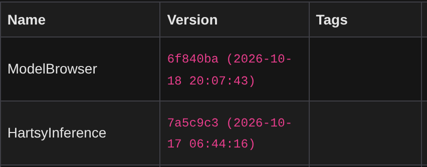

# Install HartsyInference

This guide installs the extension into an existing SwarmUI setup and confirms it loads.

## Before you start

- SwarmUI must already run on your machine. If you have not installed it yet, follow the [SwarmUI README](https://github.com/mcmonkeyprojects/SwarmUI#readme).
- Plan for a longer first start. SwarmUI compiles the extension the first time it starts.

## 1. Clone the extension

Stop SwarmUI, then open a terminal in SwarmUI's `src/Extensions` folder and clone the repository:

```bash
git clone https://github.com/HartsyAI/SwarmUI-HartsyInference-Backend.git
```

Your folder layout should look like this:

```text
SwarmUI/
└── src/
    └── Extensions/
        └── SwarmUI-HartsyInference-Backend/
```

## 2. Start SwarmUI

Start SwarmUI with the launcher for your system:

- Windows: `launch-windows.bat`
- Linux: `./launch-linux.sh`

SwarmUI compiles every extension in `src/Extensions` when it starts. The first start after cloning takes longer while the extension builds. Later starts reuse the build.

## 3. Confirm the extension loaded

1. Open SwarmUI in your browser and go to **Server** > **Extensions**.
2. Find **HartsyInference** under **Installed Extensions**.



If the row is missing or the build failed, open **Server** > **Logs**, filter for `HartsyInference`, and follow the [troubleshooting guide](06-Troubleshooting.md).

## Updating

To update, pull the latest code in the extension folder, then restart SwarmUI:

```bash
cd SwarmUI/src/Extensions/SwarmUI-HartsyInference-Backend
git pull
```

SwarmUI rebuilds the extension on the next start when the repository's commit changes. You can also use the **Update** button in **Server** > **Extensions**.

## Two backends with similar names

SwarmUI also has an **LLM: Local (HartsyInference GGUF)** backend. It belongs to the LLM Assistant extension, not to this extension. The image, video, and music backend described in these guides is **HartsyInference (Pure C# Inference)**.

## Next step

Continue to [02: First generation](02-First-Generation.md).
