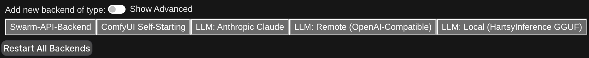

# First Generation

This guide takes you from an installed extension to a finished image.

## 1. Show the advanced backend types

1. Open **Server** > **Backends**.
2. Turn on **Show Advanced** next to **Add new backend of type**.

The HartsyInference backend type is hidden until you turn on **Show Advanced**.

## 2. Add the HartsyInference backend

1. Select **HartsyInference (Pure C# Inference)**. A new backend card appears.
2. Keep the defaults in the **Basics** section:
   - **Compute Backend**: Auto
   - **GPU**: the GPU you want to use. With one GPU, keep the first entry.
   - **VRAM Mode**: Auto (recommended)
3. Save the backend. Wait until the card shows that the backend is running.

<!-- TODO screenshot: the new HartsyInference backend card, with the default settings visible and the status showing running. Capture at 2x on a 1440 px wide window. -->

For a single GPU, leave the **Multi-GPU** section on **None**. The [backend settings guide](03-Backend-Settings.md) explains every field.

## 3. Put a model in the right folder

HartsyInference uses SwarmUI's model folders. Place a supported checkpoint in the matching folder, then refresh the model list. The [model folders guide](04-Model-Folders.md) lists each folder and the models that go in it.

For a first image, choose a fast checkpoint that fits your GPU, such as a Turbo or Schnell model. Check the model's license and hardware notes before you download it.

## 4. Generate an image

1. Open **Generate**.
2. Choose your model.
3. Enter a prompt.
4. Set the image size. For a first test, use 1024 x 1024.
5. Set the step count from the model's page. Turbo models usually need about 8 steps.
6. Select **Generate**.

<!-- TODO screenshot: the Generate tab with a HartsyInference model selected, the prompt filled in, and the Generate button visible. -->

While the image renders, SwarmUI shows progress previews. When the run finishes, the image appears in the history. Select it to see the full image, the prompt, the seed, and the generation settings.

<!-- TODO screenshot: the finished image in SwarmUI's preview with its generation details visible. -->

## If something goes wrong

- **The model does not appear:** check the model folder and refresh the list. See [04: Model folders](04-Model-Folders.md).
- **The backend does not start:** open **Server** > **Logs** and filter for `HartsyInference`. See [06: Troubleshooting](06-Troubleshooting.md).
- **A control is missing:** select the model first. SwarmUI shows only the controls the selected model supports.

## Next step

Read [03: Backend settings](03-Backend-Settings.md) to learn what each option does.
