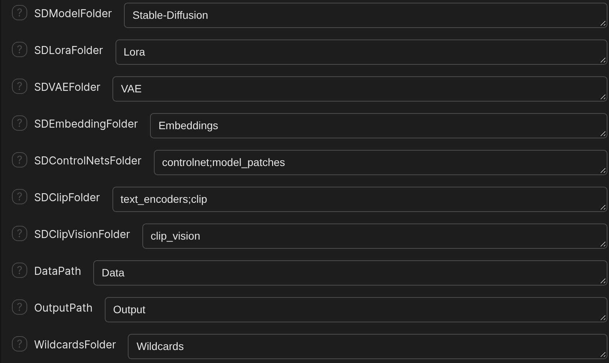

# Model Folders

HartsyInference uses SwarmUI's normal model folders. If a checkpoint shows up in SwarmUI's model list, HartsyInference can load it.

## Where the model root is

Open **Server** > **Server Configuration** > **Paths**, then find **ModelRoot**. Everything below sits inside that folder. You can list several roots separated by semicolons.

## The folders

These are the folder names from SwarmUI's default path settings.

| Setting | Default folder | Put here |
| --- | --- | --- |
| `SDModelFolder` | `Stable-Diffusion` | Image checkpoints. |
| `SDLoraFolder` | `Lora` | LoRA files. |
| `SDVAEFolder` | `VAE` | VAE files. |
| `SDEmbeddingFolder` | `Embeddings` | Textual inversion embeddings. |
| `SDControlNetsFolder` | `controlnet;model_patches` | ControlNet and model patch files. |
| `SDClipFolder` | `text_encoders;clip` | Text encoders such as CLIP and T5. |
| `SDClipVisionFolder` | `clip_vision` | Vision encoders for IP-Adapter and similar controls. |

A setting with a semicolon searches each listed folder.

Video models follow SwarmUI's [video model guide](https://github.com/mcmonkeyprojects/SwarmUI/blob/master/docs/Video%20Model%20Support.md), which saves them to a `diffusion_models` folder under the model root.

## Add a checkpoint

1. Copy the checkpoint into the folder that matches its type. Image checkpoints go in `Stable-Diffusion`.
2. Refresh the model list in SwarmUI.
3. Select the file. Choose the main checkpoint, not a VAE or text encoder.

## Some models ship as a folder

Some families, such as Lance 3B, are distributed as a folder of sharded files with an `llm_config.json`. Copy the whole folder into the model folder and refresh the list. Do not copy only one of its files.

## Companion files

Some models need a text encoder or VAE in addition to the checkpoint. Check the model's page for the files it needs. Place each file in its matching folder above, then choose it in the Generate tab when SwarmUI asks for it.

## Next step

Continue to [05: Multi-GPU](05-Multi-GPU.md) if you have a second card, or to [06: Troubleshooting](06-Troubleshooting.md) if a model is still missing.
